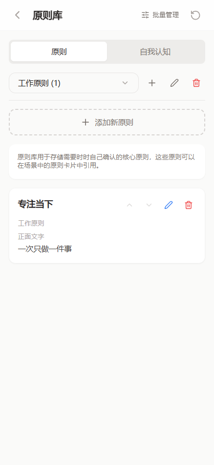
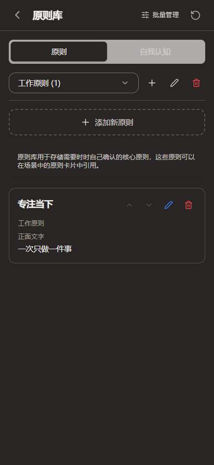
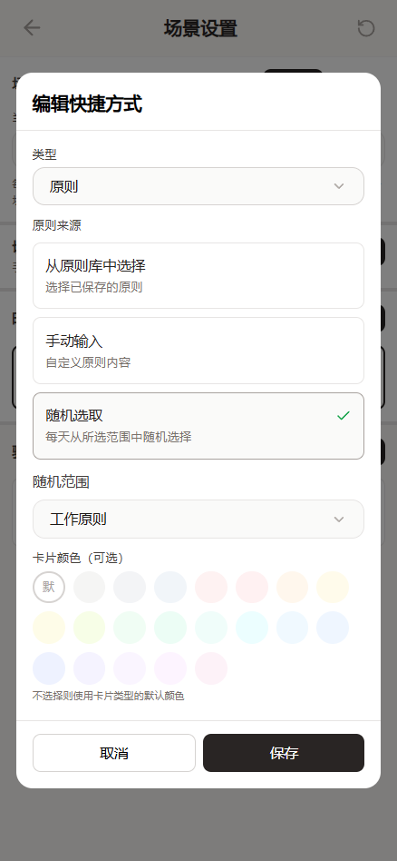
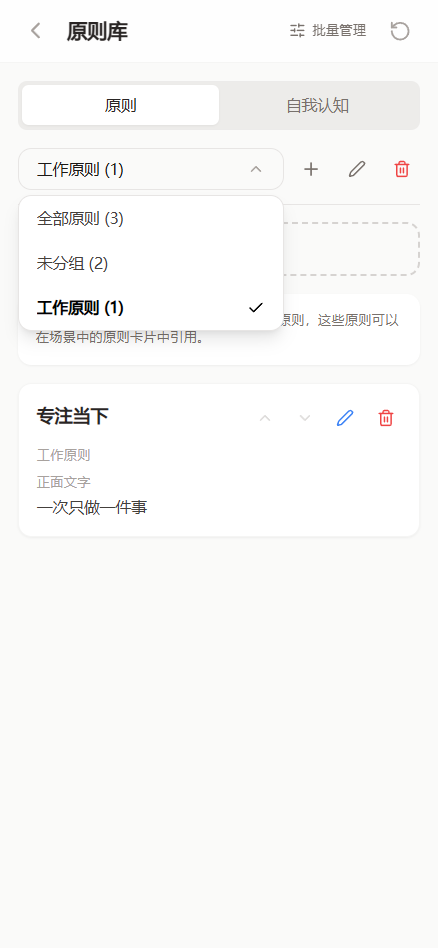
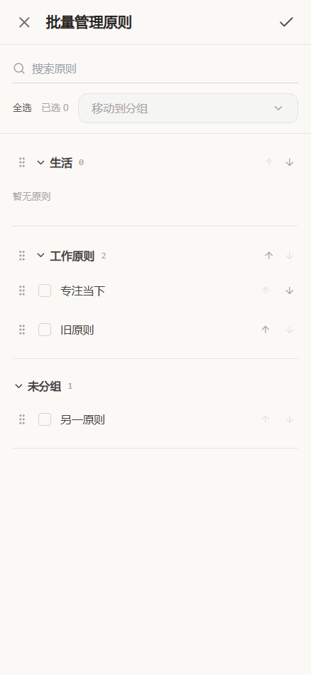
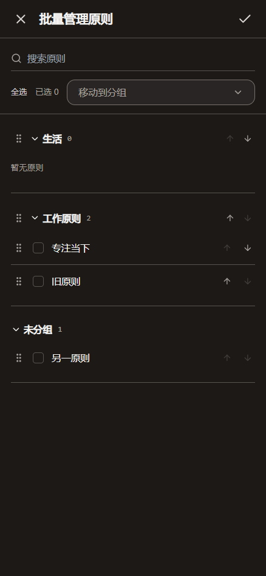

# 原则分组

在「设置 → 原则库」中，用分组筛选旁的加号新建分组。选中某个分组后，可以重命名或删除分组。创建和编辑原则时可以选择所属分组；在分组内新增原则时，默认归入当前分组。

分组筛选、原则归属和场景随机范围统一使用项目的 `CustomSelect` 下拉组件。新建及重命名分组使用灰色焦点描边。

点击原则库顶部的「批量管理」，按分组查看紧凑原则列表：

- 拖动原则左侧的手柄可换组、调整组内顺序，支持鼠标和触屏；拖到空分组或折叠的组头也能移动。
- 多选后用「移动到分组」一次移动，也可以拖动选中原则，将所选原则一起移动。
- 拖动分组手柄可调整组顺序；上下箭头也可调整分组和原则顺序。
- 支持搜索、全选和折叠分组。顶部勾号统一保存，叉号取消本次批量修改。

在「场景设置 → 编辑快捷方式 → 原则 → 随机选取」中，通过「随机范围」选择全部原则、未分组或某个自定义分组。

- 仍按现有规则每天随机一条，同一张卡片、同一分组当天保持一致。
- 修改随机范围后使用该范围独立的每日缓存；移出分组或被删除的原则不会继续被选中。
- 删除分组会将组内原则移回未分组，保留原则内容。引用被删除分组的随机卡片显示提示，需重新选择范围。
- 空分组显示空状态，不从其他分组抽取。
- 旧原则无需迁移，自动视为未分组；旧随机卡片仍从全部原则中抽取。
- 分组使用稳定 ID，改名不影响场景引用。分组定义和原则归属随 JSON 备份、云同步保存；恢复不含分组的旧原则库时清除旧分组定义。

验证命令：

```powershell
npx vitest run --config vitest.principles.config.ts
npm run build
node scripts/test-principle-groups.mjs
```

渲染测试使用隔离的 Electron/Chromium 配置和测试数据，模拟无关的上下文及图标组件，验证实际原则库、场景编辑器和场景卡片。截图显式加载 Microsoft YaHei 字体，覆盖手机宽度和深色模式。












