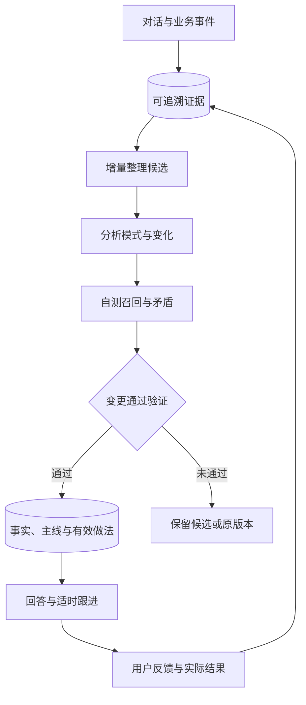

# LumosTime AI 记忆与 Dream 优化调研

_2026-10-29 · 基于当前仓库静态审阅及公开论文、官方产品文档 · 方案建议_

---

建议建立一套统一的记忆生命周期，让“跨会话理解用户、Dream 复盘学习、主动跟进”共用证据、时间、检索和反馈机制。用户已明确三个方向都需要。本次交付为调研与架构建议，以下体验、字段与调度参数均为待实现设计。

研究重点是：哪些信息值得写入，变化后如何更新，何时应该召回，Dream 如何改善实际行为，以及如何判断跟进有帮助。来源优先使用原始论文与官方文档，检索和核对日期为 2026-10-29；这是一轮针对性调研，不是穷尽文献的系统综述。

**1. 当前代码的优势与具体问题**

现有系统已有结构化 memory、前后台统一 turn、独立 Dream topics/entries、手动管理界面、提醒队列和 AI 备份。这些可以继续使用。特别是 Dream prompt 已经要求提炼“习惯 + 未来行为规则”，具备程序性记忆的雏形。

| 发现 | 代码证据 | 对体验的影响 |
| --- | --- | --- |
| 画像和偏好各最多 24 条，旧项在前，追加后取前 24 条 | [assistantMemoryService.ts](../../src/services/assistantMemoryService.ts)，`dedupeStrings`、`applyPatch` | 列表满后，新且不重复的记忆会被截掉 |
| 自动画像/偏好 patch 主要支持追加，按完全相同字符串去重 | 同上；[assistant.ts](../../src/types/assistant.ts)，`AssistantMemoryPatch` | 语义重复、相反偏好和偏好变化缺少明确更新关系；手动删除不等于自动冲突处理 |
| 当前状态和工作主线各为一个字符串，最新决策只留一条 | 同上，`lastKnownState`、`workingMemorySummary`、`recentDecisions` | 多个并行目标容易互相覆盖，完成的主线缺少生命周期 |
| 每条长期画像/偏好没有独立 ID、证据、有效期 | [assistant.ts](../../src/types/assistant.ts)，`AssistantMemory` | 难以解释为什么记住、区分用户原话与模型推断、识别过时内容 |
| Dream 召回以整段 query 的 `includes` 匹配加更新时间排序，默认取 6 条 | [dreamService.ts](../../src/services/dreamService.ts)，`buildContext` | 自然语言长问题很难整段命中，容易退化成最近更新优先 |
| Dream 召回没有过滤 `archived` 状态 | 同上，`buildContext` | 已归档内容仍可能进入上下文 |
| 手动选择月份，但聊天证据来自当前 session 的最近最多 24 个 turn | [useAIBackfillChatTemplateOpeningHandlers.ts](../../src/components/ai-chat/useAIBackfillChatTemplateOpeningHandlers.ts)，`handleDreamCommand` | 不是所选月份的跨会话聊天证据集；近期聊天可能与历史窗口不一致 |
| 月份日志按时间升序后最多取前 200 条 | [AIBackfillChatModal.tsx](../../src/components/AIBackfillChatModal.tsx)，`buildDreamRangeDictionaryContext` | 高频记录月份的后半段可能被遗漏，影响观察的代表性 |
| Dream entries 的来源只有短 `sourceSummary` | [assistant.ts](../../src/types/assistant.ts)，`DreamEntry` | 缺少可打开的消息、日志、复盘证据引用 |
| Dream 展示卡片存在反向合成持久化 entry 的兜底路径 | [dreamService.ts](../../src/services/dreamService.ts)，`synthesizedEntries` | 展示内容可能绕开正式 patch 的语义边界，建议改为只从已验证记忆生成展示 |
| 本地查询 target 没有历史聊天、memory 和 Dream | [assistant.ts](../../src/types/assistant.ts)，`AssistantLocalQueryTarget`；[assistantLocalSearchService.ts](../../src/services/assistantLocalSearchService.ts) | 能查 app 业务数据，但不能通过同一查询接口主动寻找跨会话记忆 |
| 普通 memory 和 Dream 分别存储与注入 | [assistantTurnService.ts](../../src/services/assistantTurnService.ts) | 缺少统一的冲突、有效性与上下文预算仲裁 |

以上为静态代码结论，未读取真实个人聊天或运行真实数据复现。列表截断与归档过滤问题可以直接从控制流确认；其他条目描述当前结构的局限，不代表每次交互都会发生错误。

**2. 近期研究最值得转化的机制**

| 来源 | 已核对的机制 | 对 LumosTime 的建议 |
| --- | --- | --- |
| TiMem，2026-01 首发、2026-04 修订 | 按时间和抽象层级组织记忆，逐步归并，按问题复杂度召回 | 建立事件 → 阶段模式 → 稳定偏好的层级，保留上下层证据链接。[论文](https://arxiv.org/abs/2601.02845) |
| APEX-MEM，2026-04，ACL 2026 | 保留随时间演化的事件历史，在检索时处理变化与冲突 | 保存偏好的生效和失效时间，既能回答“现在怎样”，也能回答“以前怎样”。[论文](https://arxiv.org/abs/2604.14362) |
| Hindsight，ACL 2026 系统演示 | 区分客观信息与主观信念，结合多种检索与时间过滤 | 严格区分“用户明确说过”和“AI 暂时推测”，推断不能自动升级为事实。[论文](https://aclanthology.org/2026.acl-demo.27/) |
| MemDream，2026-09-28 预印本 | 离线构造有证据的问题，诊断召回缺陷并修复，采用可逆遗忘；完整方法包含多角色与策略训练 | 借鉴“整理后主动自测”和软归档。首版用顺序阶段实现，不照搬训练和多 agent 架构。[论文](https://arxiv.org/abs/2609.34545) |
| FrontierMemory 1.0，2026-10，Letta Research | 评估从过去经验学习后，下游任务是否变好；首版只有 15 个任务 | 产品验收同时看记忆准确性和实际帮助；不拿该榜单推导本产品收益。[原文](https://www.frontiermemory.com/blog/v1/) |

这些工作支持分层、时序、证据和行为评估的设计方向，但各自模型、任务、数据和指标不同。论文结果不能直接作为 LumosTime 的预期提升数字；MemDream 的机制尤其需要本地评估验证。

**3. Personal agent 产品可以借鉴什么**

| 产品 | 官方文档描述 | 适合借鉴的体验 |
| --- | --- | --- |
| OpenClaw | Dream 分为整理候选、反思主题、筛选巩固；长期写入带来源，保留改写前状态；Dream diary 不作为再次晋升的证据 | 自动整理、可审阅变更、来源和回退；避免 Dream 反复把自己的总结当新证据。[官方文档](https://docs.openclaw.ai/concepts/dreaming) |
| Letta | 跨会话记忆，显式 remember，后台 Dream；记忆文件可版本化，更新可经过额外 agent 审阅 | 学习在后台发生，用户能看懂发生了什么；借鉴版本能力，不要求手机端运行 Git。[官方文档](https://github.com/letta-ai/letta-docs-md/blob/main/configuration/memory/index.md) |
| Hermes Agent | 紧凑常驻记忆与按需历史会话检索分开，反馈可沉淀为记忆或技能 | 关键偏好常驻，具体往事按需查；重复纠正应改变下一次行为。[官方文档](https://hermes-agent.nousresearch.com/docs/user-guide/features/memory) |
| Kin | 在聊天中标出记住的关键词，展示当天学到的内容与知识关联，允许查看和删除 | “它今天对我多了解了什么”可见；来源可达比首版知识图谱动画更有价值。[官方说明](https://mykin.ai/resources/how-to-use-kins-memory) |
| Rosebud | 从历史日记形成连续理解、回顾生活模式；文档也明确普通记忆对具体日期的回忆有限 | 把洞察带回当下复盘、目标与生活节律；LumosTime 应利用自身结构化时间数据强化日期准确性。[官方说明](https://help.rosebud.app/ai-analysis/long-term-memory) |

上表是官方描述与产品设计参考，不等于本次对这些产品完成了实际性能测试。

**4. 三种架构选择**

| 路径 | 收益 | 代价与取舍 |
| --- | --- | --- |
| 修补 v1 | 快速解决满额截断、归档、匹配问题 | 字符串列表和两套生命周期仍限制后续能力 |
| 统一条目、分层检索、渐进 Dream | 同时支撑理解、复盘与跟进，能沿用现有 turn、提醒和备份 | 需要 v2 迁移、证据索引和统一写入入口；推荐 |
| 直接引入完整外部记忆平台或图数据库 | 获得现成复杂检索能力 | 新增移动端部署、账号、网络、同步与费用依赖，且仍需适配领域语义 |

建议选择第二条。先用统一记录和轻量实体关系表达语义，以实际召回失败决定是否需要向量检索、专门图存储或外部 provider。首版的关键改造是生命周期，不是数据库品牌。

**5. 目标记忆结构**

根据后续讨论，推荐前台统一为“记忆”入口，按内容浏览；Dream 作为其中的“整理记忆”流程及整理记录。底层通过同一仓储维护来源、状态、版本与检索。统一仓储不代表所有记录拥有相同可信度或行为权限。

| 层次 | 保存内容 | 召回策略 |
| --- | --- | --- |
| 核心事实与偏好 | 用户明确要求记住的事实、稳定协作偏好 | 小而精，相关核心项常驻 |
| 当前主线 | 并行目标、进展、卡点、下一步、等待结果 | 按目标、会话和当前情境选择 |
| 经历事件 | 有时间、人物、项目与原始来源的事件 | 按需检索，不全量注入 |
| 模式与洞察 | 跨多个独立事件的模式、变化、待验证解释 | 按情境召回，明确推断性质 |
| 有效做法 | 什么情境下，什么帮助方式有效或被拒绝 | 命中适用情境后影响建议与跟进 |

建议公共字段包括：`id`、`kind`、`content`、`entityIds`、`topicIds`、`sourceRefs`、`assertionType`、`status`、`observedAt`、`validFrom`、`validTo`、`reviewAfter`、`supersedesId`、`revision`、`scope`。这些是设计字段，不是本次新增的代码接口。

`sourceRefs` 指向 session/message、log、todo、review 等具体记录，同时保存来源版本。`assertionType` 区分用户陈述、app 观察和 AI 推断。`status` 表达候选、生效、过期、被替代、归档、用户否定等生命周期；事实可信度与生命周期必须分开表达。

时间至少区分事件何时发生、系统何时得知、事实何时生效。用户今天说“我从上周开始改成晚间学习”，不能全部记成今天发生。

当前主线另保存目标状态、最近进展、待跟进问题、关联任务和退出条件。提醒仍由既有任务/提醒系统执行，记忆引用其 ID，避免生成第二套相互矛盾的任务状态。

**6. 写入和纠正应先于复杂检索落地**

1. 用户明确要求记住、纠正或忘记时，立即走统一写入入口。
2. 普通对话提取候选，用户原话和 AI 推断分开保存；助手自己的回复不能成为用户事实的唯一证据。
3. 对同一人物、项目和属性查重；区分补充、重复、变化与真正矛盾。
4. 变化使用“新版本生效，旧版本失效或被替代”，不把相反偏好平铺在列表中。
5. app 的待办完成状态以业务数据为准，不能被旧记忆恢复成未完成。
6. 所有来源变动、删除和用户纠正同步使派生记录、摘要、缓存和索引失效。

例如用户从“可以每天催我”改成“这周别催我，我在休息”，应该生成带有效区间的临时覆盖；这周内抑制跟进，之后根据原始约定或最新反馈恢复。新的一次吐槽不应自动重写长期人格。

“忘记这个”应同时阻止旧摘要或下次 Dream 再次导入。可以保存不含原文的来源排除标记与删除版本，云同步也传播删除语义；原始聊天是否一并删除由用户选择的删除范围决定。软归档用于普通遗忘，用户明确删除则尊重删除范围。

**7. 检索：让记忆在正确场景发挥作用**

每轮构建核心偏好、当前主线、相关经历、相关观察和适用做法的上下文包，按 token 预算取舍。先过滤无权限、被否定、已失效和不适用的内容，再排序。

检索首版可组合中文关键词/短语、人物与项目 ID、主题、时间区间和当前主线匹配；“同义但不含字面词”的失败案例积累后再增加 embedding。近期性只是一项排序因素，低频但长期有效的偏好不应自动被近期闲聊挤掉。

核心规则建议为：当前用户明确指令优先；用户纠正优先于旧推断；回答当前状态时采用当前有效版本；回答历史问题时采用当时有效版本。发生未解决冲突时如实表达不确定，不由模型静默挑一个。

为已有 `localQueryRequest` 增加历史会话、记忆与 Dream 检索能力，优先复用当前查询回合控制。检索返回来源片段，模型能继续展开，而不是仅拿摘要推断。多 persona 默认共享允许共享的用户事实，角色专属互动与推断应有作用域，避免角色之间无差别传播。

**8. Dream 2.0：后台维护、模式发现和自检**

Dream 继续保留用户自定义关注主题，但每个主题更适合表达一个持续问题，例如“什么条件下我容易熬夜”“什么做法能帮我启动困难任务”。可以同时记录正向模式，例如哪些安排带来稳定精力、哪些兴趣值得继续投入。

建议先实现三个顺序阶段，复用现有结构化 AI 请求，不引入多 agent 运行基础设施：

| 阶段 | 工作 | 写入边界 |
| --- | --- | --- |
| 整理 | 从上次检查点采集新增或修改的证据，去重、关联主线、提取变化 | 写候选与检查点 |
| 反思 | 分析跨事件模式、反例、阶段转折及可能有效的做法 | 写带依据的观察候选 |
| 巩固与自检 | 验证来源、合并、替代、过期，模拟查询比较更新前后答案 | 原子提交通过验证的记忆变更和变更记录 |

整理频率和推断门槛应区分：用户明确说“记住”可立即生效；由行为推测的规律需要多个独立事件及反例检查。同一个事件在聊天、日报和月报里出现三次仍只算一次证据；记忆被反复召回也不代表得到新的现实支持。

自检例子包括：“用户现在希望被提醒的频率是什么”“这个目标是否已完成”“这条观察能打开哪些原始证据”“换一种说法还能检索到吗”。预期答案必须来自原始证据，不能用 Dream 自己编出的答案证明自己正确。自检集合与独立产品评估集合分开。

输出分为已验证的记忆变更、待验证洞察和用户可读的 Dream 记录。展示记录只从实际结果生成；Dream 记录与模拟情境不进入事实证据池。没有足够新信息可以不改变记忆，不要求每个主题每次都产出结论。

每次运行记录证据游标、输入版本、变更前后版本、状态和用量。提交前检查新一轮聊天是否改过目标记录，冲突则重算，避免后台覆盖前台纠正。相同证据批次重跑保持幂等，失败不丢旧版本，预算耗尽保留检查点。

调度建议先采用“会话自然结束后轻量整理 + 有新证据时每天最多一次深度整理 + 周期性回顾”，保留手动月份重建。这里的频率是可调整的初始策略。Android 首版可在应用恢复时补跑到期任务，随后再评估原生后台调度；不能承诺应用被终止后仍能准点运行模型任务。

月份重建应使用该月份跨会话证据，按天分片、汇总后再反思，保留覆盖范围和缺失标记。旧月份导入的新观察必须服从时间有效性，不能覆盖当前偏好。

**9. 主动跟进：让理解变成适时帮助**

主动消息从未完成主线、明确承诺、相关状态变化或用户允许的关注事项产生候选。发送前先核对最新待办状态、上次联系、用户偏好、静默时段及该事项的冷却期；不适合发送时只更新内部状态。

| 情境 | 建议行为 | 反馈如何进入记忆 |
| --- | --- | --- |
| 用户说论文方法部分卡住了 | 保存卡点和约定的下一步，适时问一次具体进展 | 用户是否接受、是否明确有帮助 |
| 用户低能量时不喜欢长计划 | 推荐一个低门槛动作 | 保存适用情境与用户明确反馈 |
| 任务已完成 | 关闭关联主线跟进 | 防止旧提醒继续触发 |
| 用户说最近不要被催 | 对相应范围生效并暂停已有自动跟进 | 记录临时或长期偏好 |
| 用户在同类情境拒绝某种帮助 | 降低该做法适用性，重新询问或换方式 | 拒绝是修正信号；沉默不等于认可 |

建议记录“情境 → 做法 → 用户反馈 → 可观察结果 → 下次适用条件”。仅凭用户随后完成任务，不能证明是助手的建议导致；默认沉淀为待验证的有效做法，用户明确确认可提高其证据强度。

建议沿用现有提醒队列、scheduled task 与后台 orchestrator，新增候选生成和发送前检查，避免另建一套通知系统。用户明确的准点提醒继续按原语义执行，自主关心类跟进采用更严格的频率预算。

**10. 用户界面应让记忆可理解、可修正**

记忆页采用简洁列表，包含“关于我、最近在推进、经历、发现的规律、有效做法”；不要把底层全部字段直接展示成配置表。

条目展开后能看到记住的原因、来源、适用时间和变更历史，并支持修改、否定、忘记。用户陈述与 AI 推测有清楚区别；不必每条记忆都弹窗确认。

Dream 页展示本次学到的新内容、修正的旧理解和仍待验证的问题，并提供一键回退本次变更。源证据已被删除时，不能借回退重新恢复其派生内容。日常聊天仅在确实有意义时显示简短的记忆更新入口。

跟进设置保留清楚的控制：允许跟进的主题、频率、静默时段、暂停期限。“你为什么这么建议”可以展开本轮实际采用的记忆和观察；日常回答自然表达，不机械重复“根据你的长期记忆”。

**11. 分阶段实施与验收**

| 阶段 | 主要工作 | 可验收结果 |
| --- | --- | --- |
| 第一阶段：可靠底座 | 修复容量截断与归档召回；记忆 v2、来源、更新/替代/删除、主线结构；备份迁移 | 新记忆不会无声丢失，纠正生效，删除不会因同步或 Dream 复活 |
| 第二阶段：会用记忆 | 跨会话查询、统一上下文预算、按时间与实体召回、来源展开 | 换会话仍能衔接，能够回答当前与历史两个版本 |
| 第三阶段：自动 Dream | 增量采集、分片、模式与反例、验证、检查点、变更记录、自检 | 后台整理可重跑、可回退，重复整理不自我强化 |
| 第四阶段：适时帮助 | 主线跟进、发送前核对、频率控制、有效做法反馈 | 跟进具体、可停止，完成与拒绝会改变后续行为 |

每个阶段完成独立验证后再进入下一阶段。第一阶段就应留好后续证据和事件接口；第四阶段不必等待复杂图数据库落地。

建议修改边界：

- `src/types/assistant.ts`：v2 类型、证据引用、主线、观察和变更记录契约。
- `src/services/assistantMemoryService.ts`：迁移及统一写入仲裁；必要时拆出仓储和检索服务。
- `src/services/dreamService.ts`：增量协调、验证、版本化变更，展示卡片只消费结果。
- `src/services/assistantContextBuilder.ts`、`assistantTurnService.ts`：分层上下文与预算。
- `src/services/assistantLocalSearchService.ts`：增加历史会话和记忆查询。
- `src/services/assistantOrchestratorService.ts` 与现有调度、提醒服务：跟进候选及发送前核对。
- `src/services/assistantBackupService.ts` 与同步路径：v2、迁移、删除语义、并发版本。
- `src/components/ai-chat/`：记忆管理与 Dream 变更记录，减少逻辑继续堆入主 modal。

v1 画像和偏好迁移时标记为旧版来源，保留原文，不伪造证据或置信度；旧 Dream 同样按 legacy observation 迁移。保留来源不确定的旧数据，降低其自动决策权重，而非自动补全为用户事实。

建议使用合成多日、多会话场景建立独立验收集，比较 v1 与 v2，并做开启/关闭 Dream 对照：

| 场景 | 必须观察的结果 |
| --- | --- |
| 第 25 条有效偏好 | 保存成功，常驻上下文可有预算，但仓储不得静默丢失 |
| 用户改变偏好 | 当前回答采用新版本，历史问题能解释旧版本 |
| 两个并行项目 | 状态不互相覆盖，按项目正确衔接 |
| 删除一条观察 | 普通检索、旧摘要、再次 Dream 和云合并都不恢复它 |
| 旧月份重建 | 不把过去观察当成当前事实 |
| 日志缺失 | 区分“没有记录”与“没有发生” |
| 同一证据多次汇总 | 不虚增重复次数和可信度 |
| 已归档条目 | 不进入普通当前态召回 |
| 用户拒绝跟进 | 对应范围立即停止，后续不换说法重复催促 |
| Dream 与前台同时更新 | 用户新纠正不被后台旧版本覆盖 |

质量指标分别统计事实正确率、变化采用率、来源支持率、相关召回率、删除遵从、用户纠正次数、跟进拒绝与有用反馈、输入 token、延迟和每日后台调用用量。固定的状态约束用确定性检查；回答质量结合来源核验与人工抽样，不只依赖同一个模型给自己的总结评分。

**12. 推荐的首个可交付范围**

优先完成可靠记忆 v2、跨会话检索、基础增量 Dream，以及基于单个主线的一次可取消跟进。这一范围可以连通三种目标，验证完整闭环后再扩展复杂模式分析、更多自主行动与知识图谱展示。

预期体验示例：用户谈到论文卡住后，助手保留具体卡点；隔天换会话依然能衔接。几次明确反馈后，Dream 学到用户在低能量时更接受短时间启动建议。得到允许后，助手在合适时机询问一次进展；用户完成任务或要求暂停后，相关主线和跟进同步结束。

**13. 进一步明确：统一记忆分类，限制请求上下文**

用户进一步指出“长期记忆”和“Dream”内容重叠，并关注每轮携带内容的成本。该问题需要分别处理内容分类、维护流程与请求取用。

“长期”描述信息的留存时间；“Dream”描述信息的整理方式。它们不适合当作互斥的内容分类。同一条偏好可以直接来自用户，也可以由 Dream 从多次明确反馈中整理得出；它始终属于偏好。AI 的推断性质由来源和证据字段标明，不依靠存在哪个模块来表达。

因此推荐：内容按“关于我、进行中的事、过往经历、规律与有效做法”组织，来源单独记录为用户陈述、业务观察或 AI 推断；Dream 统一处理去重、关联、更新、巩固与纠错，保留用户原有的自定义关注主题作为整理任务配置。

请求实际携带情况经再次核对：

| 部分 | 当前行为 | 建议 |
| --- | --- | --- |
| 普通 memory | 开启后整个 snapshot 序列化，包括画像、偏好、状态、工作摘要、提醒和最新决策 | 使用专门的请求投影，只挑本轮需要的字段与条目 |
| Dream | 默认最多 6 条，并非全量；查询匹配弱，且无有效性门槛 | 统一召回，允许零命中，不强行补足条数 |
| 对话 | 共享 builder 同时生成 `recentTurns` 与 `summary`，后者基本再次拼接同一批消息 | 最近消息只出现一次，摘要只覆盖已移出窗口的历史 |
| 规则与 schema | 每次包含 memory 更新规则和输出结构 | 缩短重复定义，保留必要写入契约 |

以上只能确定结构性开销；本次未使用个人请求数据测量实际 token 占比。token 应按实际 provider 的 tokenizer 或 usage 统计，不能从中文字符数直接精确换算。

其他 agent 的官方取用机制：

- Hermes：内置两份紧凑常驻记忆，文档所列预算合计约 1,300 tokens；具体往事通过 `session_search` 查 SQLite 历史。常驻部分按会话起始快照加载，并考虑前缀缓存。[官方文档](https://hermes-agent.nousresearch.com/docs/user-guide/features/memory)
- OpenClaw：紧凑 `USER.md`、`MEMORY.md` 用于起始上下文；详细日记可经 `memory_search` 查找，再用 `memory_get` 展开。当天、昨天材料在特定新会话入口有自动加载行为，因此也不是所有信息都仅靠工具主动检索。Dream 把有价值的材料整理进入长期记忆。[官方文档](https://docs.openclaw.ai/concepts/memory)
- Letta MemFS：根目录核心文件进入上下文；带索引的子目录按需读取，目录索引帮助发现深层材料。默认文件读搜即可工作，语义索引是可选扩展；Dream 维护这套记忆。[官方文档](https://github.com/letta-ai/letta-docs-md/blob/main/concepts/memfs/index.md)

可借鉴的共同点是存储量与上下文量分离，小量核心常驻、细节按需进入。单纯把记录放进文件或数据库，不会自动节省 token；关键在请求装配器如何选取内容。

推荐 LumosTime 采用混合召回：

1. 小量核心常驻：明确且跨场景重要的偏好、当前有效的必要约束和紧凑索引。长期保存不代表每次常驻。
2. 本地自动选择：根据当前消息、最近主题、项目实体与时间条件选少量关联记忆。无需为了“决定查什么”在每个普通回合额外调用一个模型。
3. 按需展开：资料不够时，模型调用统一记忆搜索和来源展开工具，复用既有查询回合机制。简单问答可直接完成。
4. 话题结束后移出细节：检索结果进入过一次上下文后仍会占后续请求空间；需要在切换话题或压缩时移除不再相关的结果，保留必要结论和来源引用。

纯工具检索可能让模型忘记查记忆；每轮全库 RAG 则可能为简单消息引入无关片段。混合方式把自动选择作为低成本起点，并保留模型深入查询的能力。对中文首版可先用短语、主题、实体和时间匹配，再由评估决定是否引入 embedding。

建议初始预算仅作为可调工程参数：核心记忆约 250–400 tokens，当前主线约 200–400 tokens，关联记忆约 400–800 tokens，普通回合记忆上下文控制在约 1,600 tokens 上限；没有相关内容时少带或不带。该预算不包含 persona、工具定义、近期对话与业务状态，深入历史查询另设单次及整轮预算。强制约束等关键内容需预留空间，不能无声截断。

常驻内容可以保持稳定前缀，检索和动态状态放在后部；用户纠正仍必须在当前回合立即生效。前缀缓存能否节约费用和延迟取决于 provider，命中缓存也不等于相关文本不占上下文窗口。不能仅通过“只发一次”或缓存替代上下文裁剪。

建议增加按模块的请求统计：固定规则、核心记忆、召回记忆、业务状态、最近对话、历史摘要、工具结果分别占多少 tokens；同时记录命中条目和来源。优化前后使用相同场景比较 token、延迟和回答正确性，防止单纯缩短请求后遗漏重要偏好。
